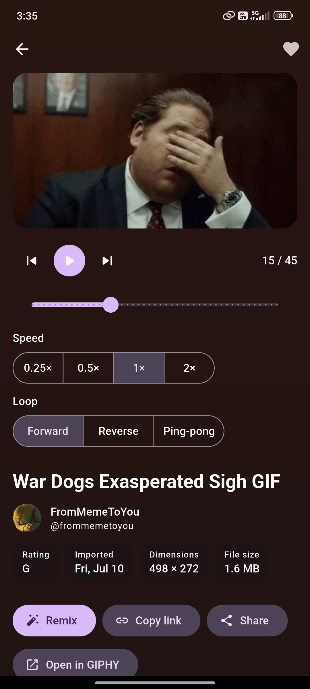
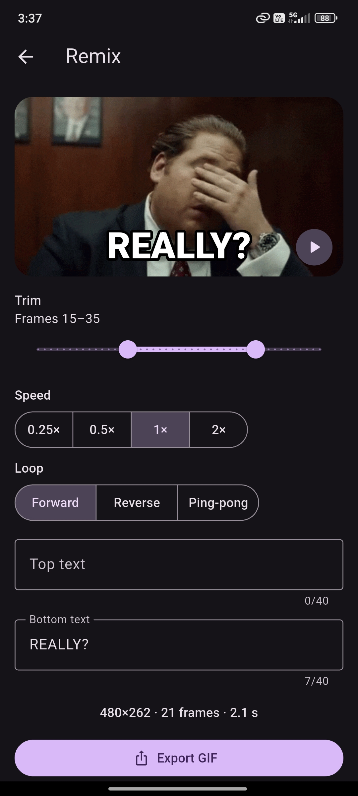

# GifLoop

A Flutter app for iOS and Android for finding, playing and remixing GIFs from GIPHY.

<p>
  
  
  
  
</p>

https://github.com/user-attachments/assets/2f7bc8e6-6840-43e3-ab66-7c9d0aae668b

## Features

- **Explore:** trending GIFs and auto search with suggestions and recent searches, in an endless masonry grid.
- **GIF Studio:** play any GIF frame by frame, with pause, scrubbing, speed and reverse.
- **Remix editor:** trim, change speed, add captions and export a new GIF to share.
- **Library:** favorites that work offline, plus your own remixes.

## Flutter version

```
Flutter 3.47.9 • channel stable • https://github.com/flutter/flutter.git
Framework • revision c197ca5199 • 2026-10-29 10:10:20 -0400
Engine • revision 89c39edfdf • 2026-10-27 19:51:20.000Z
Tools • Dart 3.13.7 • DevTools 2.60.0
```

## Getting started

1. Get an API key at <https://developers.giphy.com/dashboard/>.
2. Copy `.env.example` to `.env` and add the key:
   ```
   GIPHY_API_KEY=your_key_here
   ```
3. Run:
   ```sh
   flutter pub get
   dart run build_runner build
   flutter run
   ```

The key is compiled into an obfuscated, git-ignored file by [envied](https://pub.dev/packages/envied). Run `build_runner` again after changing `.env`.

Tests: `flutter test`

## Requirements

| Requirement                               | How it's done                                                                                   |
| ----------------------------------------- | ----------------------------------------------------------------------------------------------- |
| iOS & Android                             | One codebase, platform-adaptive UI. iOS not run (see limitations).                              |
| Auto search with delay                    | `FeedBloc`: 400 ms debounce, previous requests cancelled                                        |
| Pagination                                | Next page loads near the end of the grid, duplicates removed                                    |
| Portrait & landscape                      | Adaptive layouts on every screen. Phones: bottom bar hides on scroll. Tablets: navigation rail. |
| Error handling                            | Sealed `Failure` types (offline, timeout, rate limit, server…) with readable messages           |
| Unit tests                                | 251 tests: blocs, repositories, parsing, playback, export, widgets                              |
| Responsive, platform guidelines           | Material 3 on Android, Cupertino widgets on iOS, light & dark theme                             |
| 2+ views with GIPHY data                  | Explore (trending + search), Detail                                                             |
| Results in a grid                         | Masonry grid that keeps each GIF's aspect ratio                                                 |
| Grid item → detail view                   | Hero animation into the detail page                                                             |
| Loading indicators                        | Skeleton grid, load-more footer, detail and export progress                                     |
| Error display                             | Full-screen error with Retry; inline Retry when loading more fails                              |
| **Bonus:** state management               | BLoC / Cubit (`flutter_bloc`)                                                                   |
| **Bonus:** architecture                   | Feature-first, layered: UI → Bloc → Repository → API                                            |
| **Bonus:** navigation separate from pages | `AppCoordinator` interface, implemented with `go_router`                                        |
| **Bonus:** network availability           | Offline banner, automatic retry when the connection returns                                     |
| **Extra:** accessibility                  | Follows the system reduce motion setting: GIFs start paused, the tab bar doesn't animate        |

## Architecture

```
lib/
  app/        DI, router + coordinator, adaptive shell
  core/       network, errors, connectivity, theme, shared widgets
  features/
    gifs/     models, GIPHY API, repository
    feed/     Explore: search + grid
    search/   suggestions, trending and recent searches
    details/  detail page
    studio/   GIF player
    remix/    editor and export
    library/  favorites and remixes
```

Widgets never touch the network or the router directly. They talk to blocs and navigate through `AppCoordinator`.

## Known limitations

- **iOS** was not built or run: the app was developed on Windows.
- **GIPHY beta key** has a low hourly request limit. When it is reached, the app shows a clear message.
- **GIPHY terms** discourage storing copies of GIFs, so offline favorites and remix export would need GIPHY's approval in a production app.
- No integration tests. No account or cloud sync (the Library is behind an interface, ready for one).
